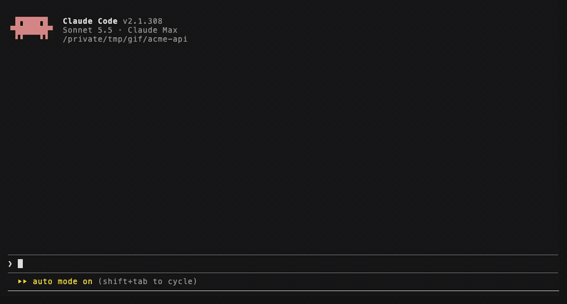
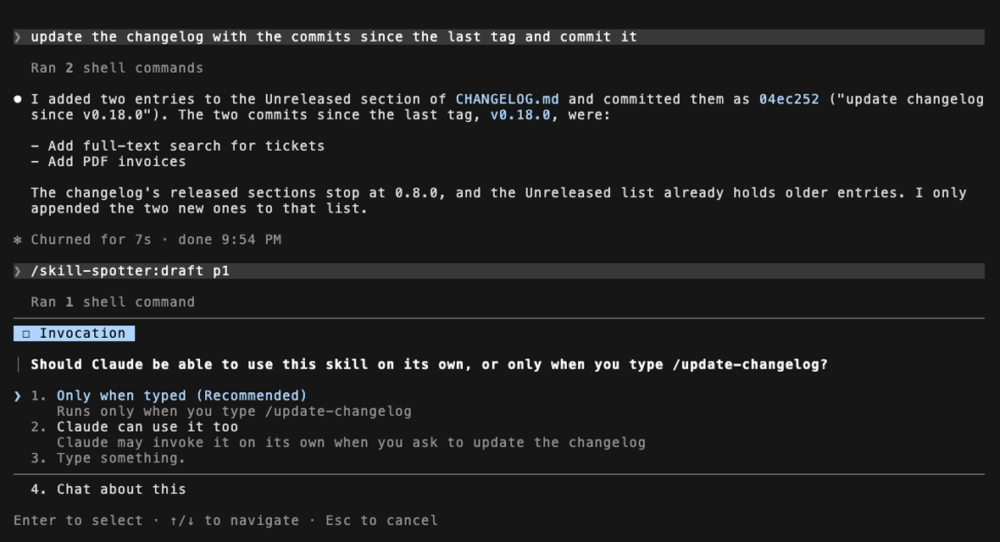
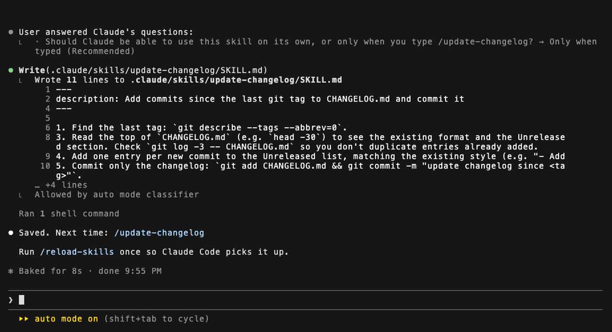
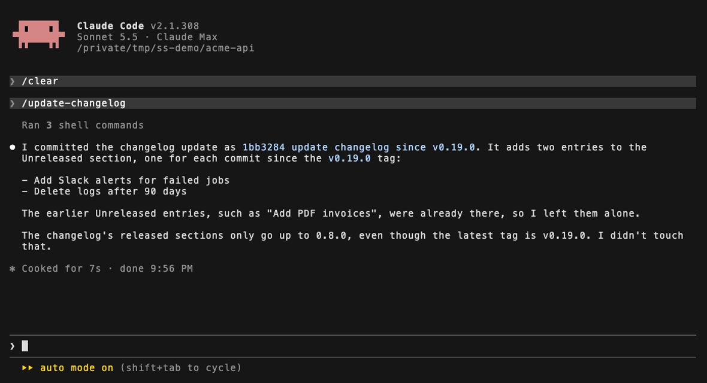
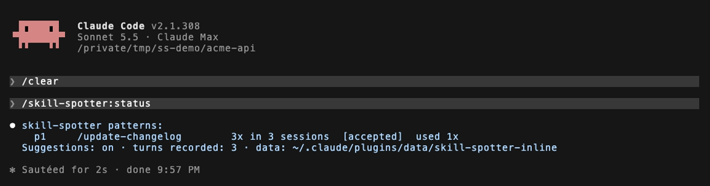

# skill-spotter

A Claude Code plugin that notices tasks you keep repeating and offers to save them as a skill you can run with `/name`.



- **Private.** Everything it records stays on your computer. Nothing is uploaded, and there's no telemetry or account. See [Privacy](#privacy).
- **Free to run.** It uses no tokens per turn. Suggestions are shown to you, not to Claude.
- **You stay in charge.** It never creates a skill on its own; you decide with `/skill-spotter:draft`.
- **Recognises the task, not just the words.** It compares what Claude *did* (commands, files, tools) as well as what you typed. So the same request still counts when Claude takes different steps, and a rephrased request counts when Claude's steps stay similar. It also spots multi-prompt workflows.
- **Spots instructions you keep repeating.** When you add the same rule to many different requests ("make sure I'm the only author, no claude"), it offers to put it in CLAUDE.md instead, so you can stop typing it.

## See it work

These screenshots come from a real Claude Code 2.1.308 session in a demo repo, after asking for the same changelog update in three sessions.

**1. Create the skill.** **[Create /update-changelog]** fills in `/skill-spotter:draft p1`. Claude reads the recorded steps, then asks one question: should only you be able to start the skill, or Claude too?



**2. It's saved** as `.claude/skills/update-changelog/SKILL.md`, with the steps Claude actually took.



**3. Next time, one command.**



**4. Track it.** `/skill-spotter:status` shows what it found and whether you use the skills you created.



## Privacy

**All data stays on your machine.** skill-spotter keeps one SQLite file in Claude Code's plugin data folder (`~/.claude/plugins/data/skill-spotter-…/`). The hooks that record your turns are plain Python with no networking code. Nothing is uploaded, and there are no analytics.

| | |
|---|---|
| **Stored** | Your prompts and the shell commands Claude ran, with secrets removed (commands are cut to 500 characters); names of files Claude read or edited, relative to the project; the domain of web pages Claude fetched; the names of MCP tools Claude called and their argument names; pattern counts; the sentences of your prompts that read like an instruction ("make sure…", "don't…"), and the names of the CLAUDE.md files a rule was written to |
| **Never stored** | Tool output, file contents, edit contents, MCP argument values, Claude's replies, secrets (API keys, tokens, passwords, private keys, credentials in URLs) |
| **Kept for** | 90 days, after which turns are deleted. Pattern summaries stay. |
| **Delete it all** | `/skill-spotter:forget` |
| **Pause** | `/skill-spotter:off` stops suggestions. To stop recording, disable the plugin. |

**When data leaves your machine.** This only happens through commands you run yourself:

- **`/skill-spotter:draft`** shows Claude the pattern's prompts (with secrets removed) and steps, so it can write the skill. They go to Anthropic as part of your conversation, like anything else you show Claude. You already sent those prompts when you first typed them.
- **`/skill-spotter:rule`** does the same with the instructions behind a rule, so Claude can write the CLAUDE.md line.
- **`skill-spotter verify`** runs `claude -p` on the skill's description and on test prompts that Claude writes. It never sends your recorded history. It spends tokens.
- **`/skill-spotter:extras`** downloads Python packages from PyPI and an embedding model from Hugging Face, once, after asking. It sends nothing about you.

**Limits worth knowing:**
- Secret removal uses patterns: known key formats, `KEY=value`, bearer tokens, passwords in URLs. A secret in an unusual format could still get through.
- The database isn't encrypted; your normal file permissions protect it.

## Install

```bash
claude plugin marketplace add ykisana/skill-spotter
claude plugin install skill-spotter@skill-spotter
```

Or try it for one session from a clone: `claude --plugin-dir /path/to/skill-spotter`.

You need Claude Code and `python3` 3.9+ on your `PATH` (macOS's built-in one works). There's nothing to `pip install`.

## Commands

| Command | What it does |
|---|---|
| `/skill-spotter:status` | Patterns found, suggestions, skills you created and how often you use them |
| `/skill-spotter:draft <pN\|wN>` | Turn a pattern or workflow into a skill |
| `/skill-spotter:rule <rN>` | Add an instruction you keep repeating to CLAUDE.md (yours or the project's) |
| `/skill-spotter:on` / `:off` | Resume or pause suggestions |
| `/skill-spotter:forget` | Delete everything stored (asks first) |
| `/skill-spotter:train` | Re-group patterns now instead of waiting for the background job |
| `/skill-spotter:extras` | Optional: install numpy, scikit-learn and fastembed (about 400 MB) for better background grouping |

The CLI (`scripts/skill-spotter`) adds the following:
- `show`, `dismiss`, `snooze` and `stats`;
- `scan-shell`, which imports your zsh/bash history so repeated shell routines count too;
- `verify`, which tests whether Claude starts a skill when it should.

## How it works

1. **Record.** Hooks save each prompt (with secrets removed) and the tools Claude used, simplified to templates: `uv run pytest -k foo` → `pytest`.
2. **Match.** When Claude finishes, the turn is compared with earlier ones on both wording and actions, in about 40 ms.
3. **Suggest.** A suggestion appears when a task has happened 3 times in 2+ sessions within 30 days, at most once per session. Trivial patterns (only `git status` or file reads) are never suggested. Anything with risky steps (`--force`, `deploy`, `rm -rf`) becomes a skill that only runs when you type it, and that asks before the risky step.
4. **Follow up.** If you ignore a suggestion it's snoozed for 14 days, then dropped. Skills you create are tracked so `status` can show whether you use them.

**Repeated instructions.** Some things you say aren't tasks but rules you attach to many tasks: "make sure I'm the only author, no claude", "keep it as one commit". skill-spotter picks out sentences that read like an instruction and reduces them to their key words, forgiving typos. When the same instruction shows up in 3 prompts across 3+ sessions within 30 days, it suggests adding it to CLAUDE.md. Unlike tasks, instructions are counted across all your projects. It stays quiet if a CLAUDE.md, `CLAUDE.local.md`, `AGENTS.md` or `.claude/rules/` file Claude Code loads already says it. `/skill-spotter:rule` writes one general line and asks whether it goes in your own `~/.claude/CLAUDE.md` or the project's.

A suggestion quotes your latest prompt, so you can see what repeated, and proposes a name when the prompts give a good one. Otherwise it offers to save "a skill", and Claude picks the name when drafting it. Claude can rename a proposed name too.

On Claude Code 2.1.287+, suggestions appear in a band above the prompt with **[Create /name]** (or **[Create skill]**, or **[Add to CLAUDE.md]**) and **[Not now]** buttons. On older versions they appear as a message under Claude's reply, which Claude Code labels `Stop says:`.

More detail is in [docs/method-lab.md](docs/method-lab.md) (how the matcher was chosen) and [docs/adr](docs/adr) (every design decision).

## Results

Measured on a synthetic benchmark: 98 task families and 6,460 turns, mostly one-offs, replayed through the real hook code ([full results](docs/benchmarks/README.md)).

| | precision | recall |
|---|---|---|
| shipped matcher, test split | 1.00 | 0.97 |
| simple rule baseline | 0.67 | 0.87 |

**These numbers are provisional.** The synthetic sessions come from templates, which makes them easier than real ones. A check on real, hand-labelled sessions (`bench.label`) still has to show precision ≥ 0.85. That needs a few weeks of real use first.

## Known limitations

- Questions you answer only by exploring don't match when they're reworded, because without actions only the wording can match.
- Small one-edit tasks with very different wording can split into two patterns. The background job merges some of them.
- A request that is reworded *and* done with different commands each time may not match. Claude often varies its commands, so in a live test, three differently worded changelog updates stayed separate. Repeating your usual wording helps.
- A file Claude edits through a shell command (a script, `sed -i`) isn't counted as an edit.

## Development

```bash
python3 -m pytest                                    # stdlib only
pipx run ruff check . && pipx run ruff format --check .
claude plugin validate .
claude plugin test                                   # the mod band
python3 -m bench.replay --quick --min-precision 0.9  # what CI replays on every push
```

The Method Lab (`bench/`) needs its own environment: `python3 -m venv .venv && .venv/bin/pip install -r bench/requirements.txt`. Manual checks for each milestone are in [docs/e2e.md](docs/e2e.md).

## License

MIT
