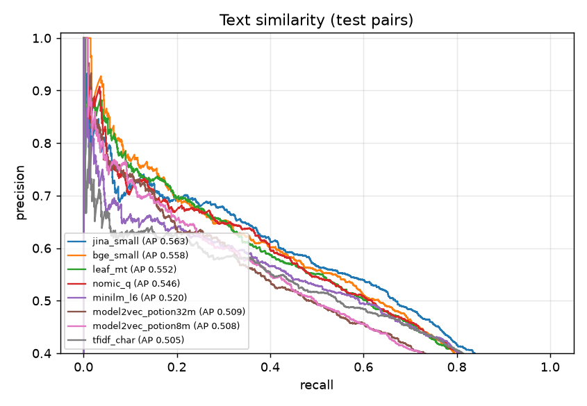
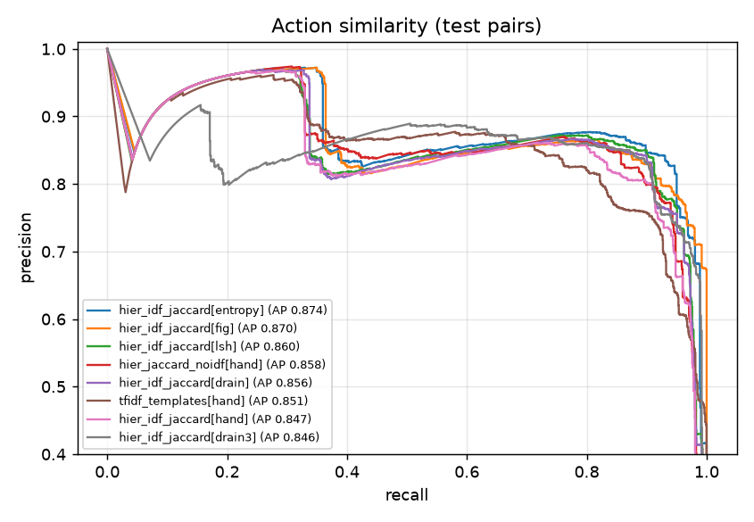
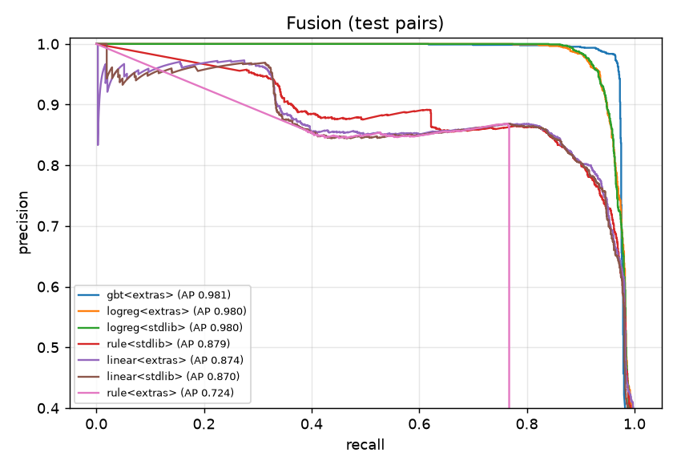

# Method Lab results

Run `2026-10-19T12:28:29` on the synthetic v1 dataset ([dataset card](../../bench/data/dataset_card.md)). Reproduce with `.venv/bin/python -m bench.run --stages text,templating,actions,fusion,cluster,replay`, then `bench.scale`, `bench.naming`, `bench.select`, `bench.report`.

**Caveat:** synthetic traces come from templates, so action similarity is easier here than on real
sessions. The real held-out check (SPEC 11.5) is still pending; the configs are provisional until it passes.

## Dataset
| split | turns | positive | hard_negative | one_off |
|---|---|---|---|---|
| dev | 3852 | 598 | 240 | 3014 |
| test | 2608 | 379 | 152 | 2077 |

Families are split by family (60% dev / 40% test): no family appears in both.

### Difficulty tiers (positives, both splits)

```
{"heavy": 294, "light": 196, "param": 193, "terse": 196, "typo": 98}
```

### Categories (all items)

```
{"data": 491, "database": 495, "debugging": 456, "deploy": 478, "deps": 412, "docs": 493, "git": 425, "infra": 480, "mcp": 488, "mobile": 498, "release": 478, "review": 404, "scaffold": 495, "testing": 367}
```

## Pairwise: text



| method | track | dev PR-AUC | test PR-AUC | test P | test R | test F1 | P@0.9 recall (test) |
|---|---|---|---|---|---|---|---|
| jina_small | extras | 0.528 | 0.563 | 0.490 | 0.677 | 0.569 | 0.000 |
| bge_small | extras | 0.527 | 0.558 | 0.433 | 0.748 | 0.548 | 0.001 |
| leaf_mt | extras | 0.513 | 0.552 | 0.445 | 0.714 | 0.549 | 0.001 |
| nomic_q | extras | 0.509 | 0.546 | 0.468 | 0.681 | 0.554 | 0.001 |
| minilm_l6 | extras | 0.500 | 0.520 | 0.430 | 0.752 | 0.547 | 0.000 |
| model2vec_potion32m | extras | 0.475 | 0.509 | 0.405 | 0.709 | 0.515 | 0.001 |
| model2vec_potion8m | extras | 0.467 | 0.508 | 0.409 | 0.696 | 0.515 | 0.001 |
| tfidf_char | extras | 0.456 | 0.505 | 0.443 | 0.716 | 0.547 | 0.001 |
| bm25 | stdlib | 0.443 | 0.490 | 0.458 | 0.595 | 0.518 | 0.001 |
| tfidf_word | extras | 0.438 | 0.477 | 0.417 | 0.687 | 0.519 | 0.000 |
| word_jaccard | stdlib | 0.413 | 0.448 | 0.368 | 0.831 | 0.510 | 0.006 |
| minhash | extras | 0.406 | 0.436 | 0.368 | 0.827 | 0.510 | 0.000 |
| arctic_s | extras | 0.360 | 0.372 | 0.339 | 0.599 | 0.433 | 0.000 |
| arctic_xs | extras | 0.357 | 0.370 | 0.327 | 0.678 | 0.441 | 0.001 |
| simhash | stdlib | 0.336 | 0.367 | 0.312 | 0.510 | 0.387 | 0.001 |

## Command templating

Grouping accuracy: calls generated from the same trace step should get the same template.

| templater | dev group F1 | test group F1 | test precision | test recall |
|---|---|---|---|---|
| hand | 0.905 | 0.852 | 0.889 | 0.818 |
| drain | 0.841 | 0.862 | 0.908 | 0.821 |
| drain3 | 0.851 | 0.870 | 0.869 | 0.871 |
| entropy | 0.871 | 0.890 | 0.957 | 0.832 |
| fig | 0.867 | 0.837 | 0.840 | 0.834 |
| lsh | 0.855 | 0.873 | 0.947 | 0.809 |

## Pairwise: actions



| method | track | dev PR-AUC | test PR-AUC | test P | test R | test F1 | P@0.9 recall (test) |
|---|---|---|---|---|---|---|---|
| hier_idf_jaccard[entropy] | stdlib | 0.842 | 0.874 | 0.826 | 0.947 | 0.882 | 0.360 |
| hier_idf_jaccard[fig] | stdlib | 0.845 | 0.870 | 0.819 | 0.909 | 0.862 | 0.364 |
| hier_idf_jaccard[lsh] | extras | 0.835 | 0.860 | 0.824 | 0.912 | 0.866 | 0.325 |
| hier_jaccard_noidf[hand] | stdlib | 0.846 | 0.858 | 0.836 | 0.857 | 0.846 | 0.330 |
| hier_idf_jaccard[drain] | stdlib | 0.834 | 0.856 | 0.831 | 0.907 | 0.867 | 0.337 |
| tfidf_templates[hand] | extras | 0.835 | 0.851 | 0.762 | 0.868 | 0.811 | 0.326 |
| hier_idf_jaccard[hand] | stdlib | 0.832 | 0.847 | 0.810 | 0.861 | 0.834 | 0.330 |
| hier_idf_jaccard[drain3] | extras | 0.821 | 0.846 | 0.822 | 0.905 | 0.861 | 0.071 |
| hier_jaccard_meaningful[hand] | extras | 0.770 | 0.784 | 0.786 | 0.885 | 0.833 | 0.330 |
| hier_idf_jaccard_meaningful[hand] | extras | 0.767 | 0.780 | 0.803 | 0.861 | 0.831 | 0.330 |
| embed_templates[hand] | extras | 0.740 | 0.761 | 0.728 | 0.908 | 0.808 | 0.150 |
| seq_edit[hand] | stdlib | 0.713 | 0.728 | 0.835 | 0.818 | 0.827 | 0.330 |
| seq_dtw[hand] | stdlib | 0.713 | 0.728 | 0.832 | 0.821 | 0.826 | 0.330 |
| seq_lcs[hand] | stdlib | 0.700 | 0.717 | 0.645 | 0.901 | 0.752 | 0.330 |
| fileset[hand] | stdlib | 0.372 | 0.354 | 0.643 | 0.356 | 0.459 | 0.284 |

## Fusion

Inputs: text = {'stdlib': 'bm25', 'extras': 'jina_small'}, actions = {'stdlib': 'hier_jaccard_noidf[hand]', 'extras': 'hier_jaccard_noidf[hand]'}.



| method | track | dev PR-AUC | test PR-AUC | test P | test R | test F1 | P@0.9 recall (test) |
|---|---|---|---|---|---|---|---|
| gbt<extras> | extras | 1.000 | 0.981 | 0.971 | 0.968 | 0.969 | 0.968 |
| logreg<extras> | extras | 0.976 | 0.980 | 0.948 | 0.936 | 0.942 | 0.936 |
| logreg<stdlib> | stdlib | 0.975 | 0.980 | 0.946 | 0.933 | 0.940 | 0.933 |
| rule<stdlib> | stdlib | 0.860 | 0.879 | 0.820 | 0.881 | 0.849 | 0.338 |
| linear<extras> | extras | 0.864 | 0.874 | 0.830 | 0.870 | 0.850 | 0.330 |
| linear<stdlib> | stdlib | 0.856 | 0.870 | 0.823 | 0.875 | 0.848 | 0.330 |
| rule<extras> | extras | 0.700 | 0.724 | 0.865 | 0.767 | 0.813 | 0.390 |

- `logreg<stdlib>` coefficients (standardised features): `{'text': 0.779, 'action': 2.093, 'seq': 1.339, 'files': -0.275, 'n_min': 2.453, 'n_max': -0.646, 'same_session': -0.159, 'log_gap_days': -0.647, 'action_x_text': -0.705, 'few_actions': -0.916}`
- `logreg<extras>` coefficients (standardised features): `{'text': 0.795, 'action': 3.173, 'seq': 1.404, 'files': -0.28, 'n_min': 2.42, 'n_max': -0.662, 'same_session': -0.17, 'log_gap_days': -0.669, 'action_x_text': -1.638, 'few_actions': -0.904}`

Test breakdown by pair type for `logreg<stdlib>`:

| pair type | n | recall / false-positive rate |
|---|---|---|
| hard_different | 808 | FP rate 0.000 |
| hard_related | 708 | FP rate 0.007 |
| heavy | 567 | recall 0.942 |
| light | 38 | recall 0.947 |
| param | 187 | recall 0.909 |
| random_oneoff | 2635 | FP rate 0.000 |
| random_other_task | 767 | FP rate 0.016 |
| shared_command | 1701 | FP rate 0.043 |
| terse | 568 | recall 0.937 |
| typo | 341 | recall 0.924 |

## Clustering

| clusterer | track | theta | test B3-F1 | B3-P | B3-R | ARI | NMI | V | one-offs left alone |
|---|---|---|---|---|---|---|---|---|---|
| louvain<extras> | extras | 0.9 | 0.994 | 0.992 | 0.997 | 0.971 | 0.999 | 0.999 | 0.987 |
| agglomerative_average<extras> | extras | 0.9 | 0.993 | 0.995 | 0.992 | 0.963 | 0.999 | 0.999 | 0.989 |
| leader<extras> | extras | 0.7 | 0.993 | 0.992 | 0.994 | 0.970 | 0.999 | 0.999 | 0.984 |
| components<stdlib> | stdlib | 0.9 | 0.992 | 0.996 | 0.987 | 0.921 | 0.998 | 0.998 | 1.000 |
| agglomerative_complete<extras> | extras | 0.5 | 0.991 | 0.990 | 0.992 | 0.959 | 0.998 | 0.998 | 0.980 |
| components<extras> | extras | 0.9 | 0.991 | 0.984 | 0.997 | 0.917 | 0.998 | 0.998 | 0.987 |
| dbscan<extras> | extras | 0.9 | 0.991 | 0.984 | 0.997 | 0.917 | 0.998 | 0.998 | 0.987 |
| leader<stdlib> | stdlib | 0.7 | 0.989 | 0.990 | 0.988 | 0.940 | 0.998 | 0.998 | 0.979 |
| hdbscan<extras> | extras | 0.5 | 0.980 | 0.985 | 0.976 | 0.852 | 0.995 | 0.995 | 0.983 |
| kmeans_reference<extras> | extras | 0.3 | 0.052 | 0.026 | 1.000 | 0.011 | 0.518 | 0.518 | 0.000 |

## Replay (product metrics)

Chronological replay with the trigger rule (3+ times, 2+ sessions, 30 days, 1 per session, 3 per day). `runtime<baseline>` drives the real hook code.

| method | split | suggestions | precision | recall | median occurrences before first | false / 100 turns | duplicates |
|---|---|---|---|---|---|---|---|
| runtime<baseline> | dev | 94 | 0.883 | 0.883 | 7 | 0.286 | 30 |
| runtime<baseline> | test | 61 | 0.918 | 0.895 | 5.000 | 0.192 | 22 |
| sim:logreg+leader<stdlib> | dev | 72 | 0.917 | 0.950 | 3.000 | 0.156 | 9 |
| sim:logreg+leader<stdlib> | test | 43 | 0.954 | 1.000 | 3 | 0.077 | 3 |
| sim:gbt+leader<extras> | dev | 63 | 0.968 | 1.000 | 3 | 0.052 | 1 |
| sim:gbt+leader<extras> | test | 39 | 1.000 | 1.000 | 3 | 0.000 | 1 |
| batch:gbt+leader+hdbscan<extras> | dev | 152 | 0.993 | 1.000 | 7 | 0.026 | 91 |
| batch:gbt+leader+hdbscan<extras> | test | 93 | 0.989 | 1.000 | 7.000 | 0.038 | 54 |
| batch:gbt+leader+agglomerative_average<extras> | dev | 164 | 0.988 | 1.000 | 7.000 | 0.052 | 102 |
| batch:gbt+leader+agglomerative_average<extras> | test | 98 | 1.000 | 1.000 | 7.000 | 0.000 | 60 |

## Lookup

Can the matcher find an earlier turn of the same task? Recall@10 on test, latency with the index padded to 100k vectors (bge-small embeddings for vector methods).

| method | recall@10 | p50 ms | p95 ms |
|---|---|---|---|
| brute_force | 0.851 | 8.351 | 8.550 |
| inverted_index | 0.644 | 0.010 | 0.022 |
| minhash_lsh | 0.434 | 0.018 | 0.027 |
| hnswlib | 0.851 | 0.310 | 0.408 |
| faiss_hnsw | 0.848 | 0.056 | 0.107 |
| sqlite_vec | – | this Python's sqlite3 can't load extensions (python.org macOS builds); not measured | |

## Naming

Judge scores (1-5, blind, Claude Sonnet) over 38 test families: runtime heuristic 2.66 (0.368 rated 4+), Claude reference 4.84. Exact match 0.158. Local LLM: not evaluated (no Ollama/llama.cpp; disk nearly full). Claude refines the name when drafting, so the heuristic only needs to be a sensible default.

## Ablation: what each change did (real-hook replay)

| matcher | dev P | dev R | test P | test R | test false / 100 turns |
|---|---|---|---|---|---|
| rule, M1 baseline (before ADR 0006) | 0.651 | 0.883 | 0.671 | 0.868 | 1.07 |
| + meaningful-only actions, text gate, no double suggestions | 0.883 | 0.883 | 0.918 | 0.895 | 0.192 |
| + swept rule `{"action_weighting": "none", "action_strong": 0.55, "action_weak": 0.4, "text_gate": 0.08}` | 0.906 | 0.967 | 0.899 | 0.947 | 0.268 |
| **chosen: logreg fusion + leader (runtime)** | 0.939 | 0.950 | 0.969 | 1.000 | 0.077 |

M4 check, the shipped runtime vs the lab's simulation of the same method (tolerance 0.05): dev difference {'precision': 0.0227, 'recall': 0.0}, test difference {'precision': 0.0153, 'recall': 0.0}.

## Multi-turn workflow mining (M5)

15 planted workflows (2-4 steps, 3-6 sessions each, noise turns between steps) among 181 sessions. Found = reported as a frequent sequence (support >= 3).

| method | found | recall | false workflows | reported | seconds |
|---|---|---|---|---|---|
| ngram_contiguous | 7/15 | 0.467 | 0 | 24 | 0.001 |
| ngram_gap1 (runtime) | 15/15 | 1.000 | 0 | 47 | 0.003 |
| prefixspan | 15/15 | 1.000 | 2 | 60 | 0.004 |
| spade | 15/15 | 1.000 | 2 | 60 | 0.013 |

## Chosen: stdlib (online tier)

```json
{
  "fusion": "logreg",
  "text": "bm25",
  "actions": "hier_jaccard_noidf[hand]",
  "clusterer": "leader",
  "theta": 0.7,
  "logreg": {
    "features": [
      "text",
      "action",
      "seq",
      "files",
      "n_min",
      "n_max",
      "same_session",
      "log_gap_days",
      "action_x_text",
      "few_actions"
    ],
    "mean": [
      0.09461264788063502,
      0.21449655092938802,
      0.2892970533023837,
      0.09345437717770055,
      2.3415396341463413,
      4.907545731707317,
      0.011814024390243903,
      2.528327001484718,
      0.03979813914172222,
      0.657469512195122
    ],
    "scale": [
      0.13992638559192944,
      0.3070372625241428,
      0.3678686548641414,
      0.2819684109361196,
      1.9075939564532516,
      1.9228022965685803,
      0.10804838368968692,
      0.9901472154546234,
      0.09223838276463267,
      0.47455595321205035
    ],
    "coef": [
      0.7789688427649706,
      2.093108133176987,
      1.3388305719452027,
      -0.2754099450049501,
      2.4533234305674103,
      -0.6459005829683172,
      -0.15868184027796636,
      -0.646665711221989,
      -0.7053055553846694,
      -0.9158815067885798
    ],
    "intercept": -5.323329914970214
  },
  "track": "stdlib",
  "method_version": "stdlib-2026-10-19",
  "evidence": {
    "precision": 0.9535,
    "recall": 1.0,
    "median_occurrences_before_first": 3,
    "false_per_100_turns": 0.077,
    "duplicate_suggestions": 3
  },
  "selected_from_run": "2026-10-19T12:28:29",
  "real_holdout": "pending: run bench.label export/pairs/label/eval (SPEC 11.5)"
}
```

## Chosen: with extras (background tier)

```json
{
  "fusion": "gbt",
  "text": "jina_small",
  "actions": "hier_jaccard_noidf[hand]",
  "clusterer": "leader",
  "theta": 0.9,
  "track": "extras",
  "method_version": "extras-2026-10-19",
  "evidence": {
    "precision": 1.0,
    "recall": 1.0,
    "median_occurrences_before_first": 3,
    "false_per_100_turns": 0.0,
    "duplicate_suggestions": 1
  },
  "selected_from_run": "2026-10-19T12:28:29",
  "real_holdout": "pending: run bench.label export/pairs/label/eval (SPEC 11.5)"
}
```
